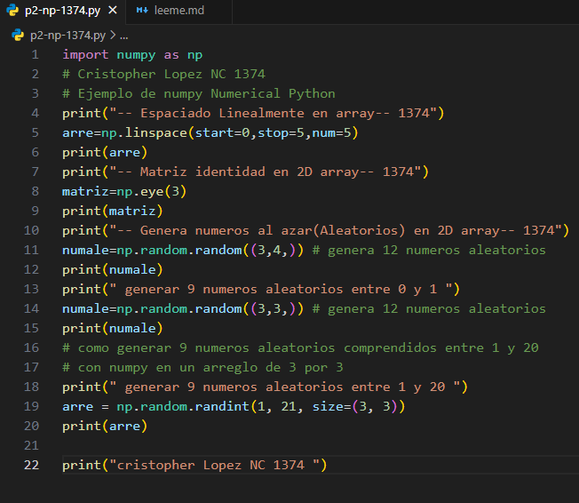
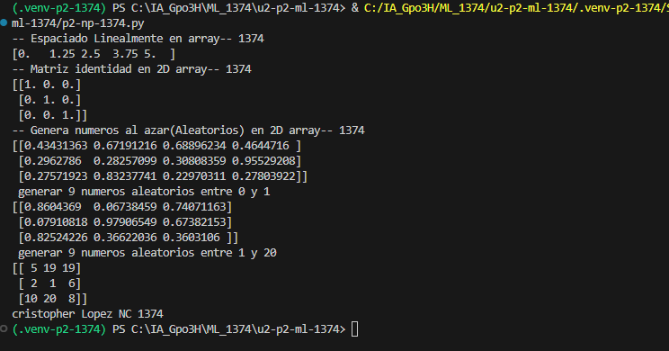

- 'start=0:' indica el valor inicial de la secuencia.
- 'stop=1:' indica el valor final de la secuencia.
- 'num=5:' indica la cantidad de números que se generarán, incluyendo el valor inicial y el final.

## que es np.linspace 
np.linspace() es una función de NumPy que genera una cantidad específica de números distribuidos uniformemente entre un valor inicial y uno final.

## El codigo

## El resultado
